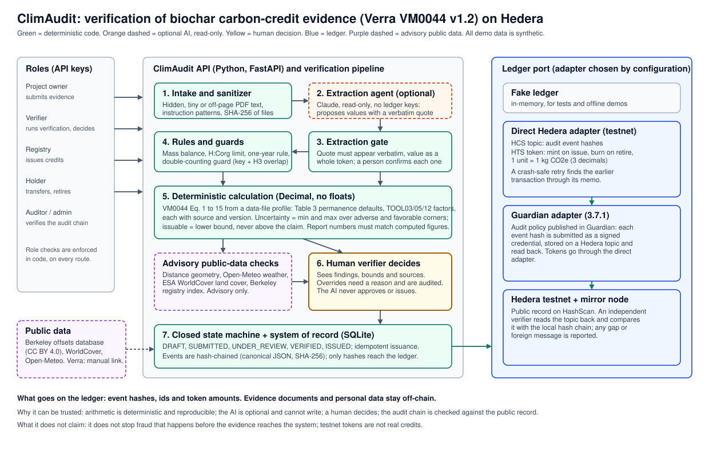

# ClimAudit: architecture diagram and specification map

`architecture.svg` is the editable vector file and `architecture.png` an image export for the Devpost gallery. If the PNG looks plain, open the SVG in a browser and take a screenshot or print it to PDF: the SVG uses the system font.

## Reading the diagram

1. **Roles** call the API with role-scoped keys. Permissions are checked per route and the state machine is closed.
2. **Intake and sanitizer** hash every file and remove or flag hidden text and instruction-like phrases.
3. **Extraction agent (optional)** proposes values with a verbatim quote; it is read-only and holds no keys.
4. **Extraction gate** accepts a value only if the quote is in the document and a person confirms it.
5. **Rules and guards** run mass balance, the H:Corg limit, the one-year rule and the double-counting guard (exact key plus H3 overlap).
6. **Deterministic calculation** applies VM0044 v1.2 from a data-file profile with Decimal arithmetic and returns a range; the issuable amount is the lower bound and never above the claim.
7. **Advisory public-data checks** (distance geometry, weather, land cover, registry index) add findings only.
8. **Human verifier** decides. Overrides need a reason and are audited.
9. **State machine and system of record** keep the batch state and the hash-chained audit events.
10. **Ledger port** sends event hashes and token operations to the adapter chosen by configuration: in-memory, direct Hedera testnet (HCS and HTS), or Guardian (audit policy) with tokens through the direct adapter. An independent verifier reads the public topic back and compares it with the local chain.

## Where the full specification is

| Topic | Document |
|---|---|
| Overall architecture, AI role, defenses | `../ARCHITECTURE.md` |
| Build contract: roles, routes, entities, evidence kinds, state machine, hash chain, Hedera and Guardian adapters, public-data checks | `../BACKEND-SPEC.md` (sections 1 to 20) |
| Data model, finding codes, error codes | `../SCHEMA.md` |
| Methodology equations, defaults and tool factors with sources | `../METHODOLOGY-VM0044.md` |
| Every design decision with its reason and the open items | `../DECISIONS-LEDGER.md` |
| Security and data-integrity assessment | `SECURITY-ASSESSMENT.md` |
| Public data research | `../research/PUBLIC-DATA-LAYER.md` |
